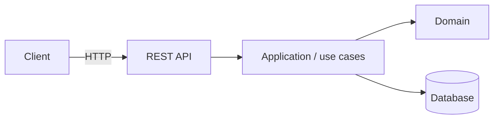

# insurance-claims-a11y

[](https://github.com/JesusBlazquez/insurance-claims-a11y/actions/workflows/ci.yml)


Car insurance policies and claims, built accessible to WCAG 2.2 AA.

## The problem it solves

<!-- 2-3 sentences, no jargon. Who has this problem and what does this project do about it? -->

## Architecture



<!-- Replace with the real diagram. One picture, the main moving parts, nothing more. -->

## Tech stack

| Area | Technology |
|---|---|
| Language | Java 21 |
| Framework | Spring Boot 4.1 |
| Build | Maven (wrapper included) |
| Testing | JUnit 5, AssertJ, Mockito |
| CI | GitHub Actions |

## Getting started

**Prerequisites:** JDK 21 (and Docker, if the project uses it).

```bash
git clone https://github.com/JesusBlazquez/insurance-claims-a11y.git
cd insurance-claims-a11y
./mvnw spring-boot:run        # Windows: .\mvnw.cmd spring-boot:run
```

Then open <http://localhost:8080/actuator/health>.

### Running the tests

```bash
./mvnw verify                 # unit + integration tests, coverage report in target/site/jacoco
```

## Technical decisions

The reasoning behind each important choice is recorded as an [Architecture Decision Record](docs/adr/).

| Decision | Why | ADR |
|---|---|---|
| <!-- e.g. Hexagonal architecture --> | <!-- one line --> | [0001](docs/adr/0001-record-architecture-decisions.md) |

## What I would do differently / next steps

<!-- Honest list: known limitations, what you would add with more time, what you learned. -->

## License

[MIT](LICENSE) © Jesús Blázquez Durán
